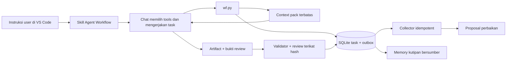

# Arsitektur implementasi native chat

Satu chat menjadi executor. Helper Python stdlib menyediakan state dan pemeriksaan deterministik.
Pemisahan ini membuat alur bisa dipakai sekarang lewat tool terminal tanpa extension tambahan.

`project.py` menangani identitas dan scope root relatif; `state.py` menggunakan transaksi SQLite,
WAL dan compare-and-swap revision. `engine.py` mengelola lifecycle dan reservasi output.
`feedback.py` mengumpulkan proposal dan mengelola kutipan sumber. Export checkpoint JSON adalah
turunan database; tidak menjadi sumber kebenaran kedua.

State utama: ready → running → needs_review/repair_needed → completed/partial. Unknown outcome
berhenti di blocked_outcome sampai rekonsiliasi berbukti. Cancel_requested membutuhkan penilaian
native terhadap proses yang mungkin masih berjalan. Transisi dan event disimpan satu transaksi.
Collector boleh diulang; proposal tidak otomatis dipromosikan.

Helper mencegah dua task aktif yang kooperatif memiliki output yang sama. Ini bukan sandbox OS
atau lock bagi editor/tools lain. Pemeriksaan hash mendeteksi perubahan pada titik pengecekan;
tidak menjamin tidak ada perubahan bersamaan setelah pemeriksaan. Jangan jalankan dua writer
independen pada artifact yang sama. Review dan checkpoint dapat ditolak jika revisi sudah berubah.

Relokasi mempertahankan UUID dan binding relatif, serta memeriksa ulang isi aturan dan sumber.
Perubahan aturan dari ancestor pada lokasi baru sengaja membatalkan kelanjutan. Backup DB tidak
memuat file artifact dan tidak membuktikan kesegaran revocation setelah restore.

Lifecycle proses MCP, admission sumber daya, dispatch agent/provider, metrik token native, dan
memory semantik masih backlog. Project ini tidak menyatakan semua fase arsitektur acuan selesai.
