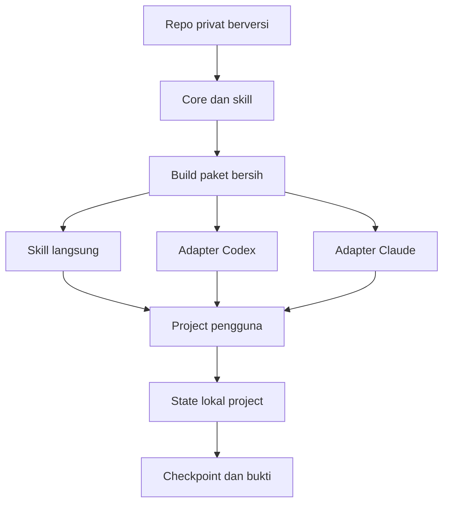

# PRD: Agent Workflow sebagai toolkit dan plugin portabel

Status: siap dijadikan spesifikasi implementasi; fitur target di bawah belum dinyatakan selesai.
Disusun 2026-10-24. Bahasa kerja: Indonesia. Pembaca: Claude atau Codex yang membuka repo ini
melalui `agent-workflow.code-workspace`, termasuk chat baru tanpa riwayat percakapan.

## 1. Hasil yang diminta

Ubah kit yang sudah ada menjadi **satu repo GitHub privat yang dapat dipasang ulang di komputer
baru**, dengan core CLI Python dan satu skill kanonis. Sediakan paket plugin untuk Claude Code
dan Codex pada surface yang mendukung, serta jalur pemasangan skill langsung untuk VS Code.
Pertahankan fitur workflow dan optimasi output yang sudah berjalan.

Mulai dari kode dalam repo ini. Jangan membangun orchestrator baru, mengganti core, atau
memerlukan project research, path mesin lama, MCP server, maupun provider key.

Untuk memulai, user cukup membuka workspace dan mengirim:

> Implementasikan `docs/PRD-PORTABLE-PLUGIN.md` menggunakan agent-workflow. Kerjakan implementasi
> lokal dan seluruh validasi yang tersedia. Publikasi GitHub mengikuti izin eksplisit pada pesan
> saya; jika belum ada izin publikasi, siapkan hasil lokal dan laporan kesiapan publikasi.

Prompt yang juga mengizinkan pembuatan repo privat, commit, push, dan release ada di
[RUN-PORTABLE-PLUGIN.md](RUN-PORTABLE-PLUGIN.md). Membaca PRD ini saja tidak menjalankan apa pun
dan tidak memberi izin eksternal.

## 2. Konteks dan baseline yang harus dipertahankan

Root awal pada mesin pembuat adalah `C:\Users\mywork\Documents\project\agent-workflow`.
Path ini hanya untuk menemukan project saat ini; **bukan konstanta runtime produk**. Setelah
workspace dibuka, temukan root dari workspace/source yang benar, bukan dari current directory
terminal yang belum diverifikasi.

| Komponen existing | Lokasi | Perilaku yang dipertahankan |
|---|---|---|
| CLI | `wf.py` | Lifecycle task, doctor, pack, checkpoint, evidence, review, verify, memory |
| Core | `workflow_core/` | SQLite transactional state/outbox, scope, integrity dan revocation |
| Output | `workflow_core/outputs.py` | Capture, bounded preview, retrieval tanpa replay, metrik byte |
| Skill kanonis | `skills/agent-workflow/SKILL.md` | Current native chat menjadi executor; launcher skill-relative |
| Installer awal | `scripts/install_chat.py` | Link skill; menolak mengambil alih skill milik sumber lain |
| Tes | `tests/`, `scripts/verify_portability.py` | Core, output, multi-folder dan copied-kit fixtures |
| Workspace | `agent-workflow.code-workspace` | Titik masuk pengembangan untuk Codex/Claude |
| State lokal | `.agent-workflow/` di setiap project | Tetap privat dan terpisah, tidak ikut distribusi |

Baseline terakhir dari implementasi sebelumnya adalah 37 tes lulus dan dua copied-kit fixtures.
Itu catatan historis; jalankan ulang tes saat implementasi dimulai dan jangan menganggapnya bukti
untuk revision baru. Repo source mungkin belum diinisialisasi Git; periksa sendiri dan pertahankan
semua file serta state yang ada. Jangan menghapus state untuk memulai ulang.

`CLAUDE.md` adalah instruksi project kanonis; `AGENTS.md` mengarah ke sana. Baca keduanya dan
skill sebelum bekerja. Jangan menggandakan aturan ke manifest/plugin atau menimpa instruksi
project pengguna saat memasang produk.

## 3. Pengguna dan skenario utama

| Skenario | Hasil yang harus dialami pengguna |
|---|---|
| Membuka workspace kit dengan Codex | Bisa menunjuk PRD ini dan melanjutkan implementasi dari checkpoint |
| Membuka workspace kit dengan Claude | Menggunakan core dan sumber skill yang sama; tidak membutuhkan versi kode khusus Claude |
| Memakai dua client bergantian | Task/state tetap konsisten pada project yang sama; tidak ada dua penulis output tanpa koordinasi |
| Komputer baru Windows | Clone privat, cek prasyarat, pasang skill/plugin, doctor, lalu jalankan task |
| Komputer baru Linux | Alur setara dengan Python/Git yang tersedia; tidak bergantung PowerShell/junction Windows |
| Menggunakan pada project lain | Kit terpasang sekali; state dan binding milik project target, bukan milik kit |
| Update atau kembali ke versi lama | Versi teridentifikasi; instalasi dapat dialihkan tanpa merusak task atau menimpa skill lain |

Default dukungan distribusi v1: Windows dan Linux. macOS boleh didokumentasikan sebagai belum
diuji sampai ada eksekusi aktual. Jangan mengklaim semua client/OS telah qualified hanya karena
manifest valid atau CLI tersedia di PATH.

## 4. Scope v1 dan yang ditunda

Wajib pada v1:

- Repo source mandiri, versi produk tunggal, arsip release bersih dan checksum.
- Core Python 3.10+ standard library; Python 3.10 dan versi stabil terbaru yang tersedia diuji
  dalam CI. Pilih minor stabil terbaru pada M0 dari sumber resmi Python, catat versi dan tanggal,
  lalu pin matriks itu selama qualification satu release; jangan menggeser target di tengah M5/M6.
  Batas minimum boleh berubah hanya dengan alasan kompatibilitas dan dokumentasi.
- Skill langsung untuk Codex dan Claude; plugin adapter untuk keduanya dengan katalog privat
  yang sesuai client. Installer mendukung `codex`, `claude`, atau `both`.
- Instalasi, pemeriksaan, update, dan uninstall yang mengenali kepemilikan file.
- Tes existing tetap lulus; tes distribusi/cache dan instalasi komputer baru ditambahkan.
- Dokumentasi quickstart, support matrix, upgrade/rollback, dan publikasi privat terverifikasi.

Di luar scope v1: marketplace publik, PyPI/npm publik, MCP wrapper baru, API gateway, UI web,
resident model, otomatisasi multi-agent, perubahan provider, dan aktivasi global hook RTK.
RTK tetap dependency opsional yang dipasang terpisah dengan versi/hash bila digunakan. Distribusi
produk tidak perlu membawa binary RTK, model weights atau dependency mesin research.

## 5. Keputusan arsitektur

### 5.1 Satu source, beberapa cara memasang

Core dan skill tetap di repo yang sama. Plugin adalah kemasan distribusi/adaptasi host, bukan
tempat menulis ulang logic workflow. Tidak ada fork core atau salinan skill yang diedit manual
untuk Claude/Codex. Jika build menghasilkan salinan, salinan itu generated dan dapat dibuat ulang
dari sumber yang sama; drift harus terdeteksi oleh pemeriksaan build/CI.

Struktur target konseptual berikut boleh disesuaikan jika validasi client membuktikan kebutuhan
lain. Agent wajib mencatat alasan pada decision log, bukan mempertahankan layout yang gagal.

```text
agent-workflow/
  wf.py
  workflow_core/
  skills/agent-workflow/
  VERSION                         # atau satu sumber versi ekuivalen
  plugin.json                     # portable entry point bila cocok client tervalidasi
  .claude-plugin/plugin.json       # adapter Claude, bila diperlukan
  .claude-plugin/marketplace.json  # katalog privat Claude
  .codex-plugin/plugin.json        # fallback Codex bila memang diperlukan
  .agents/plugins/marketplace.json # katalog Codex, mengikuti schema tervalidasi
  scripts/
    install_chat.py               # existing entry point tetap kompatibel
    install.py                    # target interface baru, belum tersedia saat PRD ditulis
    build_release.py
    verify_distribution.py
  tests/
  docs/
  .github/workflows/ci.yml
  agent-workflow.code-workspace
```

Nama/lokasi katalog harus diverifikasi terhadap client dan dokumentasi saat implementasi.
Jangan menyalin schema Claude ke Codex hanya karena sama-sama memakai istilah marketplace.
Gunakan satu paket plugin root yang mencakup core + skill + launcher; katalog boleh merujuk
root repo jika client mendukung dan pengujian membuktikannya. Bila perlu subfolder hasil build,
source katalog yang dipublikasikan harus benar-benar tersedia dalam ref Git yang dituju.
**Jangan membuat katalog remote menunjuk `dist/` yang di-ignore atau file di luar paket.**

### 5.2 Paket plugin harus mandiri

Launcher yang disalin ke plugin cache harus menemukan core dari paket itu sendiri. Ia tidak
boleh mengikuti path ke checkout asli, project research, atau direktori sibling yang tidak ikut
diunduh. Pindahkan/hilangkan akses ke source fixture saat menguji cache untuk membuktikannya.

Plugin/skill harus menargetkan project user secara eksplisit. Current directory plugin cache
tidak boleh otomatis dianggap project user dan tidak boleh menjadi lokasi state/task pengguna.
Output, policy discovery dan registered roots tetap mengikuti `--project` target.

Arsip dan pemasangan lokal menggunakan staging bersih dengan allowlist file produk. Jangan
memasang plugin langsung dari root development yang berisi state privat jika client menyalin
seluruh folder. Paket final tidak boleh berisi junction/symlink menuju mesin pembuat.

Arti build yang dapat direproduksi pada F03 adalah kesetaraan **daftar path dan SHA256 isi file
produk** dari revision/config yang sama. Catat toolchain dan normalisasi metadata archive jika
memungkinkan. Byte-identical ZIP lintas OS/toolchain bukan acceptance v1; setiap archive tetap
memiliki checksum-nya sendiri yang diverifikasi saat download/install. Jangan menyebut checksum
archive sebagai bukti kesetaraan dua build tanpa membandingkan manifest isi file.

### 5.3 State dan konfigurasi tetap di luar paket

| Data | Tempat yang benar | Masuk repo/release? |
|---|---|---|
| Core, skill, installer, manifest, tests dan panduan generik | Source/release | Ya |
| Task DB, evidence, captured output dan checkpoint | `.agent-workflow/` project target | Tidak |
| Ownership receipt installer | Scope instalasi lokal, tanpa credential | Tidak |
| GitHub login, token/API key, env dan session DB client | Penyimpanan native masing-masing tool | Tidak |
| Path instalasi dan binding roots | Konfigurasi lokal/relatif project | Tidak sebagai konstanta produk |
| Laporan validasi siap dibagikan | Dokumen ringkas tersanitasi | Ya, setelah review |

Default upgrade tidak mengubah schema DB atau task existing. Bila perubahan schema benar-benar
diperlukan, tambahkan migrasi teruji, backup dan batas rollback secara eksplisit. Jangan mengubah
metadata agar state lama terlihat seolah sudah lulus validasi di lokasi baru.

### 5.4 Kemampuan host berbeda dari kemampuan core

Jalur skill langsung wajib berfungsi meskipun plugin tidak tersedia pada surface tertentu.
Validasi ulang dukungan Codex IDE/CLI/desktop dan Claude Code pada versi aktual. Dokumentasi
OpenAI yang diperiksa saat penyusunan menyebut plugin pada CLI/desktop dan keterbatasan IDE;
jangan menjadikan keadaan itu asumsi permanen.

Runtime proof dibedakan menjadi: `not-installed`, `manifest-validated`, `installed`, dan
`native-smoke-passed`. Menguji core lewat Python tidak sama dengan membuktikan discovery plugin
atau eksekusi dari native client. Untuk client yang belum tersedia, tulis status sebenarnya dan
sediakan prosedur smoke; jangan memanggil model/client lain otomatis hanya untuk mendapat badge
parity. Handoff antar-Claude/Codex memakai checkpoint, bukan dua executor tak terkoordinasi.



## 6. Persyaratan fungsional dan acceptance

Setiap ID harus ditautkan ke bukti nyata dalam laporan implementasi. Bukti boleh berupa hasil
command, assertion fixture, file manifest/hash, atau native smoke. Kolom acceptance menjelaskan
hasil yang diharapkan, bukan hasil yang sudah terjadi.

| ID | Persyaratan | Acceptance yang dapat diperiksa |
|---|---|---|
| F01 | Core existing tetap kompatibel | Tes existing lulus; command/exit semantics tetap atau perubahan didokumentasikan dengan uji migrasi |
| F02 | Versi tunggal | CLI dapat melaporkan versi; seluruh manifest dan nama release konsisten; drift ditolak |
| F03 | Build bersih | Arsip produk dapat dibuat ulang dari ref source; manifest checksum cocok; tidak ada private data/path dependency |
| F04 | Paket cache mandiri | Skill launcher dari paket hasil ekstraksi menjalankan doctor/task pada target ketika checkout asal tidak tersedia |
| F05 | Instalasi client | Opsi codex/claude/both; scope project/user; target/scope ditampilkan; dry-run tidak menulis |
| F06 | Idempotensi dan ownership | Install kedua tidak menggandakan entry; skill milik sumber lain dan file user yang dimodifikasi tidak ditimpa |
| F07 | Upgrade/rollback | Peralihan versi teruji pada fixture; task DB/checkpoint pengguna tidak ditulis ulang atau hilang |
| F08 | Uninstall terbatas | Hanya artefak instalasi yang masih terbukti milik paket dihapus; state/project rules dan skill lain utuh |
| F09 | Adapter Claude | Manifest/katalog valid menurut CLI/schema yang tersedia; paket self-contained; runtime level dicatat |
| F10 | Adapter Codex | Manifest/katalog valid pada versi client; jalur skill langsung tetap bekerja saat plugin surface tidak mendukung |
| F11 | Target project eksplisit | Tes cache tidak membuat state di direktori plugin; multi-folder registered roots tetap benar |
| F12 | Capture/retrieval dipertahankan | Raw integrity, bounded JSON, exact retrieval, repeat-read accounting dan null native usage tetap diuji |
| F13 | Portabilitas OS/path | Windows dan Linux; path spasi/Unicode; working directory asing; dependency research/mesin asal tidak diperlukan |
| F14 | Prasyarat terlihat | Doctor/install melaporkan Python/client/Git/RTK opsional; tidak memasang provider/model atau mereset hook |
| F15 | GitHub privat | Target owner/repo diverifikasi, visibility PRIVATE, remote tepat, tidak ada force push atau secret tracked |
| F16 | Release dan fresh clone | Tag versi + checksum; fresh clone/ref install dari private repo berhasil tanpa source checkout lama |
| F17 | Dokumentasi satu pintu | README memberi alur komputer baru, per-client support, update/rollback, troubleshooting dan batas metrik |
| F18 | Recovery/handoff | Checkpoint menunjuk phase terakhir dan bukti; external write tidak pasti direkonsiliasi sebelum dicoba ulang |

Target interface installer berikut adalah **usulan yang harus dibuat**, bukan command existing:

```text
python scripts/install.py install --client codex|claude|both --scope project --project ROOT --dry-run
python scripts/install.py install --client codex|claude|both --scope project --project ROOT
python scripts/install.py check --client codex|claude|both --scope project --project ROOT
python scripts/install.py update --client codex|claude|both --scope project --project ROOT --version VERSION
python scripts/install.py uninstall --client codex|claude|both --scope project --project ROOT --dry-run
```

Tambahkan user scope dengan lokasi sesuai host. Sintaks final boleh disederhanakan jika semua
perilaku acceptance tercapai dan dokumentasi diperbarui. Update berangkat dari versi/checkout
yang dipilih secara eksplisit; tidak perlu self-updater yang mengunduh dari internet. Installer
existing `install_chat.py` tetap dipertahankan atau menjadi wrapper kompatibel.

## 7. Rencana eksekusi bertahap

### M0 — Inventaris dan baseline

1. Baca instruksi, PRD, README, core/skill/installer/tests yang relevan. Identifikasi Git root,
   state existing, client yang tersedia, versi tool, root target dan izin publikasi pada pesan user.
2. Jalankan doctor dan tes baseline. Periksa source/plugin docs resmi terkini untuk schema,
   root lookup, cache packaging dan dukungan surface. Catat URL serta versi yang benar-benar diuji.
3. Gunakan agent-workflow dari current chat. Buat task per milestone/output jika diperlukan;
   jangan membuat satu task 60 menit yang diam-diam diasumsikan mencakup seluruh implementasi.
4. Siapkan decision log dan checklist F01–F18. Jangan mengubah source di luar root hanya untuk
   membuat environment pembuat terlihat cocok dengan produk.

### M1 — Versi dan distribusi mandiri

Tetapkan satu sumber versi, tambah version reporting dan build release allowlist. Perbaiki
launcher agar berjalan dari source checkout maupun paket/cache. Buat verifikasi archive contents,
checksum dan runtime dengan source origin tidak tersedia. Uji compatibility CLI existing.

### M2 — Installer dan lifecycle

Implementasikan target-client/scope, dry-run, idempotensi, ownership receipt dan check.
Tambahkan update/rollback tanpa mutasi state target serta uninstall terbatas pada instalasi owned.
Uji collision, file dimodifikasi user, dan kegagalan sebagian tanpa replay yang merusak.

### M3 — Adapter plugin dan katalog

Implementasikan manifest/katalog minimal untuk Claude dan Codex, mengikuti schema yang benar-benar
divalidasi. Paket tidak wajib mengaktifkan MCP atau hook. Uji instalasi dari staging/katalog lokal
yang bersih; pastikan versi, sumber katalog dan core di cache konsisten. Jalur skill langsung
tetap menjadi fallback. Jika schema memerlukan generated bundle, check mode mendeteksi drift.

### M4 — Qualification lokal dan dokumentasi

Jalankan suite distribusi/installer, regression, portability, serta benchmark payload existing
untuk memastikan fitur output tetap berjalan. Jalankan native smoke pada client yang menjadi
executor saat tersedia: discovery skill/plugin, doctor, satu task kecil sampai verify, dan lokasi
state diperiksa. Catat client lain secara jujur sebagai belum native-smoke-passed jika belum diuji.

Tulis panduan komputer baru dari folder kosong, tanpa sibling research, custom C:/apps atau
credential pembuat. Siapkan CI Windows/Linux dan pemeriksaan paket; CI publikasi tidak boleh
memerlukan provider key, model inference atau auth pribadi pada unit/integration tests.

### M5 — Repo privat dan candidate upload

Hanya jalankan bila pesan user mengizinkan create repo/commit/push. Tanpa izin itu, selesaikan
semua pekerjaan lokal yang dapat diverifikasi dan laporkan `ready_for_private_publish` atau
daftar blocker; jangan menganggap publikasi sudah terjadi.

Default target repo baru adalah `yusronMu77/agent-workflow`, **private**. Owner itu adalah
parameter tujuan user dari konteks setup, bukan hasil `gh auth` yang boleh diasumsikan benar.
Periksa identitas aktif dan akses terhadap owner tersebut saat eksekusi. Bila user menyebut target
lain secara eksplisit pada pesan eksekusi, gunakan target tersebut dan catat perubahannya. Bila
owner/akun tidak cocok, minta user memilih akun/target; jangan mengunggah ke akun aktif lain.

- Bila belum ada Git lokal, init dan commit file produk yang telah direview saja. Bila Git sudah
  ada, periksa root/status/remote; jangan nested-init di repo lain atau mengganti origin diam-diam.
- Gunakan auth native GitHub (`gh`/Git atau connector yang tersedia); jangan meminta token ditempel
  ke chat atau menyimpan credential ke repo/config produk. Auth belum tersedia tidak menghalangi
  penyelesaian lokal, tetapi publikasi menunggu login user.
- Bila target belum ada dan create privat diizinkan, buat repo **private**. Bila sudah ada,
  periksa owner/visibility/history: jangan mengubah repo publik menjadi privat tanpa instruksi
  khusus, dan jangan mengganti sejarah/nonempty repo yang tidak sesuai.
- Sebelum upload, review diff dan daftar file tracked/staged, scan secret dan isi archive, lalu
  tunjukkan ringkasan konkret. Jika izin publish sudah eksplisit dan target sesuai, lanjut tanpa
  meminta persetujuan identik lagi; tetap patuhi approval native yang berlaku.
- Push candidate yang telah lulus pemeriksaan lokal ke repo privat agar CI bisa berjalan.
  **Candidate upload bukan klaim final release lulus.** Jangan force push; jika hasil create/push
  tidak pasti, cek remote/ref/commit terlebih dahulu dan rekonsiliasi sebelum retry.

### M6 — CI, private install, dan release

Tunggu/periksa CI Windows/Linux pada commit candidate. Jika lingkungan lokal tidak menyediakan
Linux, CI adalah bukti eksekusi Linux; hasil hipotetis atau file workflow saja tidak cukup.
Perbaiki failures yang relevan dengan task, tanpa melemahkan assertion.

Setelah CI lulus, uji fresh clone/ref dari repo privat pada folder/profile fixture baru, lalu
install dan smoke core/skill. Periksa katalog private Git auth dengan client yang tersedia;
login `gh` tidak otomatis membuktikan auth marketplace client lain. Catat support level per client.
Jangan mengunggah secret untuk memaksa tes marketplace privat lulus.

Untuk F16, minimal **satu client yang mendukung plugin harus benar-benar mengambil dan memasang
paket melalui katalog/repo privat**, lalu membuktikan discovery dan satu native smoke task dari
instalasi itu. Fresh clone + direct skill install saja tidak memenuhi bukti jalur plugin privat.
Client kedua boleh belum native-qualified sesuai bagian 8. Pisahkan status per jalur, misalnya
Codex IDE/direct skill, Codex CLI/plugin, dan Claude Code/plugin; jangan memindahkan badge uji
dari jalur skill ke plugin. Bila akses/runtime plugin privat belum tersedia, candidate tetap
boleh diunggah tetapi final release menunggu bukti ini.

Baru tandai release stabil/tag final setelah acceptance inti terpenuhi. Buat release privat
dengan archive/checksum bila izin prompt mencakup release, pastikan asset berasal dari ref yang
diuji, dan verifikasi ulang visibility serta remote SHA. Bila CI/akses client belum memungkinkan,
laporkan candidate + blocker dan lanjutkan dari checkpoint nanti; jangan menulis status selesai.

## 8. Matriks validasi minimum

| Area | Skenario yang harus diuji |
|---|---|
| Regression | Semua tes existing; suite tambahan installer/package dan error handling |
| Paket bersih | Raw state, env, auth, model, caches, local junction, absolute machine dependency tidak ikut |
| Runtime paket | Extract ke path spasi/Unicode, source asal tidak tersedia, jalankan dari cwd asing |
| Multi-project | Dua target independen dan multi-folder, DB project UUID berbeda |
| Client/scope | codex/claude/both; project/user scope dalam fixture, install ulang, collision |
| Lifecycle | Upgrade dan rollback dua versi fixture; uninstall owned; file user/state tetap utuh |
| Unknown effect | Simulasi interrupted install/push, inspeksi/reconcile sebelum retry |
| Output | Integrity/hash, preview incomplete, retrieval exact, overhead short output, usage native null |
| OS/versi Python | Windows dan Linux CI; Python minimum dan terbaru yang dipilih secara eksplisit |
| GitHub | Akun/target/private, CI pada commit tepat, fresh clone dan checksum release |
| Native host | Support level tiap client dan versi yang benar-benar diuji; validator bukan native smoke |

Release v1 memerlukan F01–F18, CI Windows/Linux lulus, dan minimal satu native client smoke.
Smoke yang memenuhi F16 berasal dari instalasi plugin privat, bukan hanya direct skill.
Kedua adapter wajib dibuat dan diperiksa; client kedua boleh berstatus manifest-validated/installed
bila runtime tidak tersedia, **asalkan label dukungan tidak mengklaim native parity** dan ada
prosedur smoke. Kekurangan ini harus tercantum pada release notes. Klaim "native verified untuk
Claude dan Codex" hanya boleh dibuat jika keduanya benar-benar lulus native smoke.

MacOS, hook RTK, generic MCP interception dan savings biaya provider bukan acceptance v1.
Metrik byte fixture tidak boleh dipasarkan sebagai pengurangan token/kuota total sesi.

## 9. Dokumen dan bukti delivery

Agent implementasi menyerahkan:

1. README/quickstart komputer baru beserta perintah final yang benar-benar tersedia.
2. `docs/IMPLEMENTATION-PORTABLE-PLUGIN.md`: keputusan, perubahan, matriks F01–F18, cara pakai,
   hasil validasi, support level, batasan, upgrade/rollback dan pekerjaan tersisa.
3. `docs/PRIVATE-PUBLISH.md`: target repo, auth prerequisite tanpa secret, release/update flow,
   cara install dari repo privat, dan recovery external write.
4. Ringkasan CI/tes, versi/hash paket, serta bukti repositori privat dan commit/tag setelah publikasi.
   Simpan log mentah/checkpoint di state privat atau CI artifacts, bukan source repo pengguna.
5. Checkpoint durable yang menyebut milestone terakhir, file yang berubah, bukti aktual dan langkah
   berikutnya. Resume harus memeriksa drift policy/source/artifact, bukan mengulang seluruh fase.

Kode, README dan docs produk tidak boleh bergantung pada note/file di sibling research.
Sejarah pengembangan yang menyebut mesin lama boleh dipertahankan sebagai riwayat dengan label
yang jelas; jangan menyalin log pribadi atau path user-specific ke panduan instalasi generik.
Tidak ada perubahan LICENSE/legal grant tanpa dasar kepemilikan dan keputusan owner; repo privat
tidak mengharuskan memilih lisensi open-source.

## 10. Cara menjalankan sebagai agent baru

1. Verifikasi root workspace, baca instruksi project dan PRD ini.
2. Jalankan `python wf.py doctor`. Jika belum initialized, gunakan init sesuai instruksi; jika
   legacy/broken, inspeksi dan pertahankan state. Jangan menghapus DB atau mengedit generated state.
3. Cari task implementasi yang masih aktif. Resume setelah integrity check bila memang task yang
   sama; jika belum ada, mulai workflow `code` dengan output implementasi di bagian 9 dan review
   requirements yang sesuai acceptance. Bangun dan baca context pack.
4. Kerjakan M0–M6; checkpoint per milestone. Pertanyaan preferensi yang sudah diberi default
   tidak perlu diulang. Mintalah input hanya untuk target/auth/konflik nyata yang tak bisa diputuskan.
5. Catat review beserta evidence aktual lalu verify. Status task completed lokal tidak sama dengan
   release privat selesai; gunakan task terpisah bila scope, deadline atau output berbeda.

Jika Claude dan Codex dipakai bergantian, executor pertama menyimpan checkpoint lalu menyerahkan
pekerjaan; executor kedua membaca instruksi/task/evidence terbaru. Penggunaan dua client tidak
mengizinkan dua proses menulis file task/output yang sama secara serentak.

## 11. Referensi untuk diverifikasi saat implementasi

Referensi eksternal diperiksa saat penyusunan 2026-10-24; schema/fitur dapat berubah. Gunakan
dokumentasi resmi dan client aktual saat implementasi, bukan menganggap contoh lama sebagai API.

- [OpenAI: Package your plugin](https://developers.openai.com/plugins/build/plugins) — portable
  manifest dan opsi compatibility overlay/katalog; verifikasi client surface dan path paket.
- [OpenAI: Plugins](https://learn.chatgpt.com/docs/plugins) — dukungan surface dan lifecycle skill/plugin.
- [Claude: Plugin manifest reference](https://code.claude.com/docs/en/plugins-reference) — manifest,
  containment path, component layout dan validasi.
- [Claude: Create a marketplace](https://code.claude.com/docs/en/plugin-marketplaces) — katalog privat
  dan pengujian lokal sebelum hosting.
- [README kit](../README.md), [arsitektur existing](ARCHITECTURE.md),
  [optimasi output](TOKEN-OPTIMIZATION.md) — sumber lokal; PRD ini sudah memuat konteks minimum
  sehingga tidak perlu membuka project research untuk memahami tujuan.
